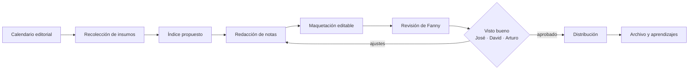
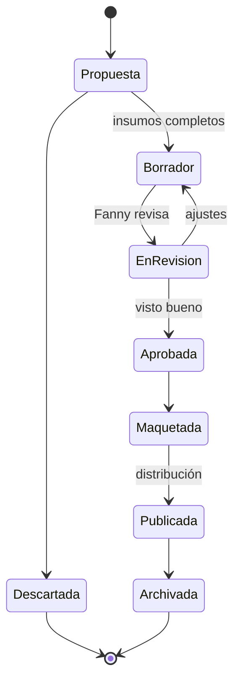

# Diseño del sistema · Conecta · v0.1 (propuesta para discusión)

*28.OCT.2026 · Documento de trabajo generado con asistencia de IA · Requiere validación del Dr. Cervantes y de Fanny*

## 1. Objetivo
Que Fanny produzca cada mes una edición de Conecta con **un día de trabajo en lugar de una semana**, con calidad consistente, aprobaciones claras y sin depender del consultor desde el 18-dic.

## 2. Flujo de una edición

## 3. Agentes (roles; la herramienta es intercambiable)
| Rol | Qué hace | Herramienta primaria | Respaldo | Datos |
|---|---|---|---|---|
| **Editor** | Propone el índice, reparte notas y detecta lo que falta | Claude (Project "Conecta Daclaf") | GPT | N2 |
| **Redactor** | Escribe notas y versiones cortas para correo y WhatsApp en el tono de Conecta | Claude | GPT | N2 |
| **Cumpleaños y calendario** | Arma la sección del mes desde la tabla de empleados | Claude | — | N2 (datos personales) |
| **Diseño** | Maqueta HTML editable, PowerPoint o Word con la guía de Mister D | Claude (HTML) · agente de diseño `[POR DEFINIR]` | Genspark | N1 y activos oficiales |
| **Guardián de marca y datos** | Revisa tono, grafía de Mister D, "aportación" y autorizaciones de foto | Claude | — | N2 |
| **Distribución** | Prepara el correo y los mensajes de WhatsApp, y el checklist de envío | Claude + conecta@daclaf.com | — | N2 |

**Clasificación de datos:** N1 público (artes publicadas, productos) · **N2 interno** (tabla de empleados, fotos, notas en borrador) solo en cuentas corporativas · N3 no aplica salvo mensajes de la dirección antes de publicar.

## 4. Estados de una nota

## 5. Calendario hacia el 18-dic
| Fecha | Hito | Nota |
|---|---|---|
| 28-oct | Contenido y diseño de la edición 1 terminados (Fanny) | Faltan datos de la edición 1 (ver `CONTEXTO.md` §6) |
| 30-oct o 1-nov | Piloto a 10–20 contactos y publicación de la edición 1 | Confirmar fecha oficial y que 1-nov es domingo |
| 3–13-nov | Edición 2 con el sistema ajustado; **última edición con acompañamiento** | Medir tiempo real de Fanny |
| 13-nov | **Entrega para operar sola:** guía de 1 hoja, 3 prompts probados, checklist, accesos | Condición para la ausencia |
| 15-nov | Publicación de la edición 2 | Domingo |
| 17-nov → 3-dic | Ausencia del consultor | Fanny prepara y publica la **edición 3** (1-dic) sola |
| 4–18-dic | Revisión de la edición 3, ajustes finales del sistema, capacitación y cierre | Criterios de cierre firmados |

## 6. Qué significa "opera sola" (checklist de aceptación)
- [ ] Fanny entra al Project desde su cuenta corporativa y desde el celular.
- [ ] Tiene acceso a la carpeta de insumos y a conecta@daclaf.com.
- [ ] Produce el índice, las notas y la maqueta de una edición sin ayuda, en un tiempo acordado `[POR DEFINIR]`.
- [ ] Conoce la cadena de aprobación y quién sustituye a cada aprobador.
- [ ] Hay un calendario editorial de 6 meses y una plantilla de insumos que RH y las áreas conocen.
- [ ] Hay una guía de estilo de Mister D vigente.
- [ ] Existe un procedimiento para corregir errores después de publicar.

## 7. Riesgos principales
| Riesgo | Mitigación |
|---|---|
| Edición 3 durante la ausencia | Entrega para operar sola el 13-nov y soporte por mensaje con respuesta acordada |
| Accesos sin liberar | Escalar con David el 29-oct; fecha límite 31-oct |
| Datos personales en notas y fotos | Regla de autorización, uso solo en cuentas corporativas y revisión del Guardián |
| Una sola persona operando | Segunda persona capacitada como respaldo |
| Cobertura parcial de canales | Combinar correo, WhatsApp y pantallas; medir lecturas |
| Cambios de fecha y de marca | Calendario editorial y guía de estilo como fuente única |

## 8. Preguntas abiertas
1. ¿Fecha oficial de la edición 1: 30-oct o 1-nov? ¿Y se envía en domingo?
2. ¿Quién libera los accesos (Rubén) y para cuándo? ¿David autorizó conecta@daclaf.com?
3. ¿Canal oficial: correo, WhatsApp, pantallas, HTML interactivo o una combinación?
4. ¿Cuál es la grafía oficial del personaje y existe guía de estilo?
5. ¿Quién respalda a Fanny durante la ausencia y quién aprueba si alguno de los tres no está?
6. ¿La política de RH sobre uso de fotos y cumpleaños de empleados?
7. ¿Dónde está el archivo maestro de RH?
8. ¿El sistema corre en la nube o en un equipo local? ¿Qué equipo usará Fanny?
9. ¿Qué métrica de éxito se medirá (lecturas, participación, tiempo de producción)?
10. ¿Se necesita una versión para quienes no usan correo (planta)?
