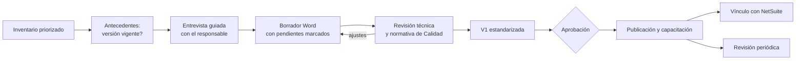
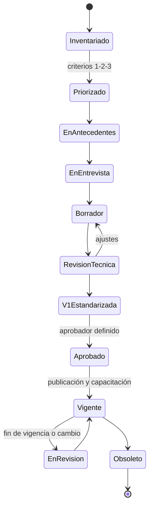

# Diseño del sistema · PNOs · v0.1 (propuesta para discusión)

*28.OCT.2026 · Documento de trabajo generado con asistencia de IA · Requiere validación del Dr. Cervantes y de Calidad*

## 1. Objetivo
Pasar de "un PNO en un día" a **un PNO en horas de trabajo de Calidad**, con calidad consistente, control de versiones y un vínculo con NetSuite, de modo que Irene y su equipo operen el sistema solos desde el 18-dic.

## 2. Flujo por PNO

## 3. Estados de un PNO

Los pendientes de un PNO no impiden llegar a **V1 estandarizada**, pero deben estar marcados en amarillo y listados; un PNO con pendientes críticos no pasa a **Aprobado**.

## 4. Roles del sistema (la herramienta es intercambiable)
| Rol | Qué hace | Herramienta primaria | Datos |
|---|---|---|---|
| **Entrevistador** | Conduce la entrevista y registra respuestas | Claude (Project "PNOs Calidad") | N2 |
| **Redactor** | Produce el borrador Word y el diagrama de flujo | Claude Desktop con Word | N2 |
| **Validador de referencias** | Lista normas, códigos y formatos citados y marca lo no confirmado | Claude + Perplexity o NotebookLM para normas públicas | N1 y N2 |
| **Control de versiones e inventario** | Mantiene el inventario Excel, versiones y estados | Claude + Excel | N2 |
| **Material visual** | Diagramas HTML interactivos y PowerPoint con iconos y lenguaje claro | Claude | N2 |
| **Resumen diario** | Revisa correo y calendario de Irene a las 8:00 y prioriza (tarea programada de Claude; borradores de correo sin envío automático) | Claude | N2 |

La validación técnica y normativa es **siempre humana** (Calidad y, en el PNO 016, el responsable sanitario).

## 5. Vínculo PNO ↔ NetSuite (base ligera; propuesta a confirmar con quien administre NetSuite)
Del trabajo de arquitectura de datos de julio se retoma lo mínimo para que los PNO se reflejen en el sistema.
| PNO | Qué debe reflejar NetSuite | Propuesta |
|---|---|---|
| **016 Proveedores** | Estado del proveedor: aprobado, no aprobado, bloqueado; alta solo con dictamen | Campo de estado de aprobación; fecha del dictamen; criticidad; fecha de la última evaluación. Relaciona con la tabla de proveedores (M03) de la arquitectura de julio |
| **016 Evaluación** | Desempeño que alimenta el informe de recepción del almacén | Reporte del almacén de insumos como fuente; calificación ponderada por proveedor |
| **002 Documentación** | Registros electrónicos como alternativa a los manuales | Definir qué registros viven en NetSuite y cómo se resguardan `[POR VERIFICAR rastro de auditoría contra ALCOA]` |
| **010 HACCP** | Registro de puntos críticos | `[POR DEFINIR]` tras la entrevista |

## 6. Capacidad y ruta al cierre
Cálculo (supuestos): 59 PNOs DASAM; 5 borradores generados `[POR CONFIRMAR si están dentro de los 59]`; del 28-oct al 18-dic hay unas 7,3 semanas. **Faltan 54: unos 7 PNOs por semana.**

| Fechas | Hito |
|---|---|
| 28-oct → 15-nov | Inventario priorizado (15-nov); definición de "100 %"; convención de codificación; protocolo de aprobación; licencias; 5 borradores en revisión |
| 3–13-nov | Carril rápido para PNOs sencillos; entrenamiento de las dos personas adicionales; **entrega para operar solo (13-nov)** |
| 17-nov → 3-dic | Ausencia del consultor: Calidad produce con el sistema; revisión con respaldo acordado |
| 4–18-dic | Cierre de DASAM: PNOs priorizados en V1 revisados; capacitación y vínculo con NetSuite |
| 18-dic | Cierre del Proyecto 2 para DASAM |
| ene-2027 | DACLAF ~190 PNOs con el sistema operando; cierre de Calidad el 15-ene-2027 |

## 7. Qué significa "opera solo" (aceptación)
- [ ] Calidad entra al Project y a Word desde sus cuentas; licencias de 3 a 4 personas confirmadas.
- [ ] Un PNO nuevo pasa de entrevista a V1 sin ayuda del consultor, en un tiempo acordado `[POR DEFINIR]`.
- [ ] Hay convención de codificación, plantilla y guía de estilo vigentes.
- [ ] Hay protocolo de aprobación y de control de versiones, con responsables.
- [ ] El inventario priorizado se actualiza solo con cada cambio de estado.
- [ ] Hay un responsable de ajustar las instrucciones del asistente y un proceso para solicitar cambios.

## 8. Riesgos principales
| Riesgo | Mitigación |
|---|---|
| "100 %" ambiguo | Definirlo el 15-nov con Irene y David |
| Ritmo insuficiente | Carril rápido, personal adicional y priorización 1-2-3 |
| Validación normativa débil | Revisión humana obligatoria y lista de referencias por PNO |
| Pendientes críticos sin dueño | Responsable y fecha por pendiente en el inventario |
| Ausencia del consultor | Entrega operativa el 13-nov y respaldo definido |
| Códigos heredados de DASAM | Convención oficial antes de emitir V1 |

## 9. Preguntas abiertas
1. ¿Qué significa "100 %": V1 estandarizada, revisado o aprobado?
2. ¿Cuántos PNOs hay en total por entidad y línea, y los 5 borradores están dentro de los 59?
3. ¿Quién aprueba cada PNO y cuál es el ciclo de revisión (3 años en DASAM, 2 en DACLAF)?
4. ¿Convención oficial de codificación y encabezados para DACLAF?
5. ¿Qué licencias se aprobaron y para quién? ¿Quiénes son las dos personas adicionales?
6. ¿Quién administra NetSuite para configurar los estados de proveedor?
7. ¿Frecuencia de evaluación de proveedores: anual o trimestral? ¿Ponderaciones y umbral?
8. ¿Quién es el líder del HACCP y quiénes integran el equipo multidisciplinario?
9. ¿Existen versiones previas vigentes de los PNOs para no rehacerlos desde cero?
10. ¿Dominio y cuenta correctos de Calidad (daclaf o daclav)?
